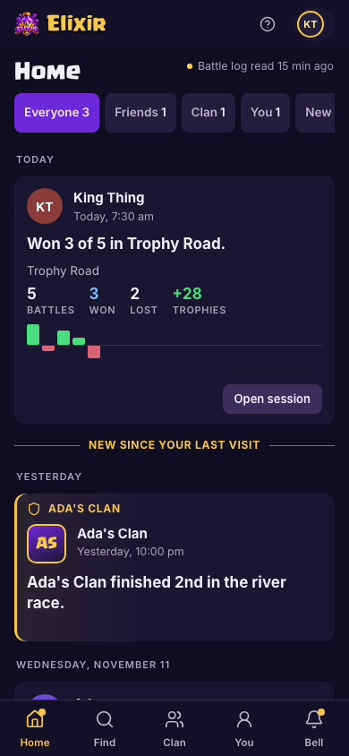
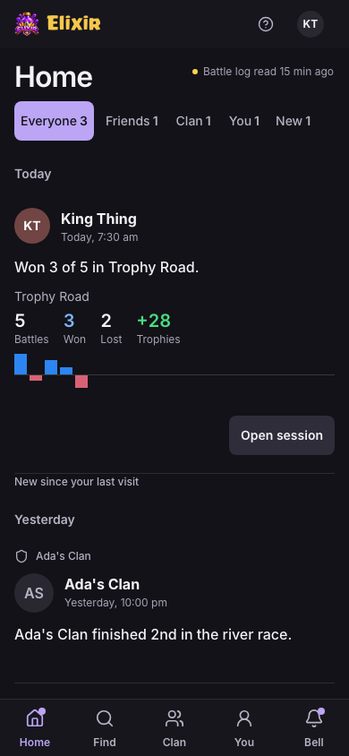
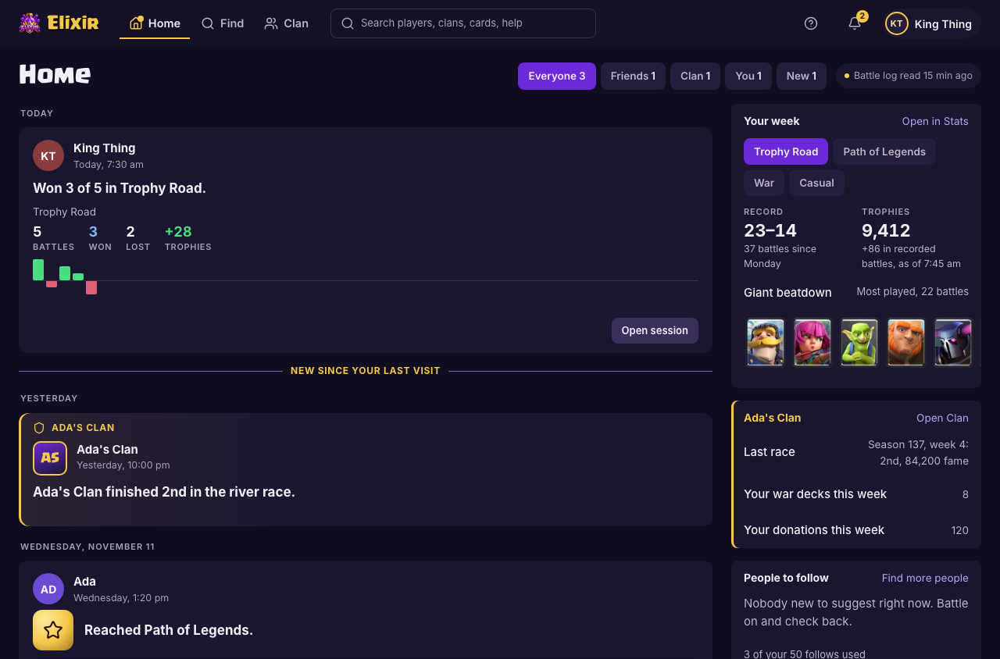
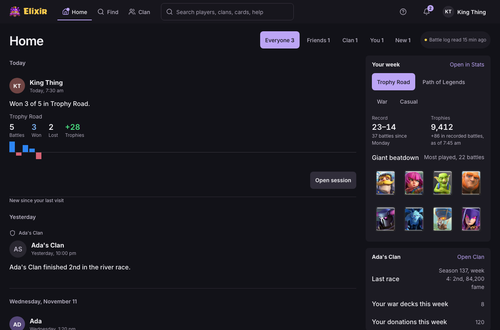
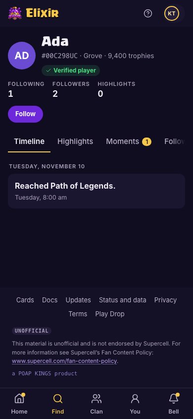
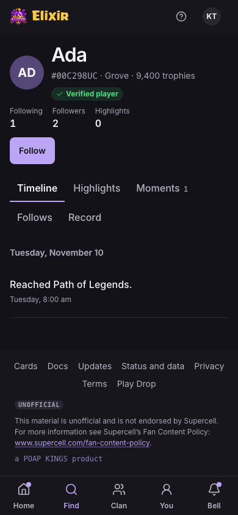
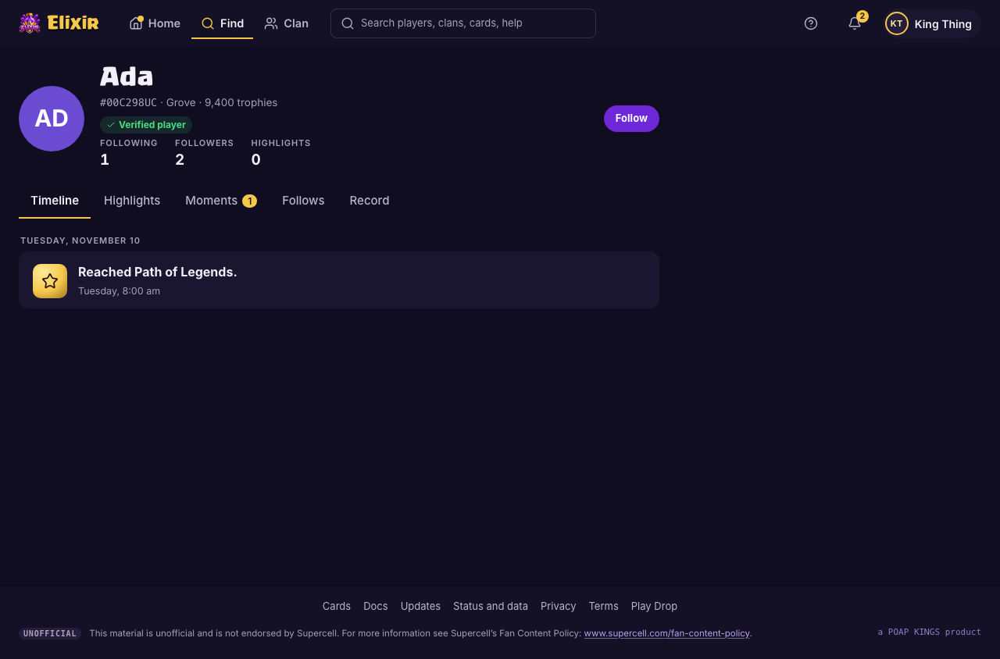
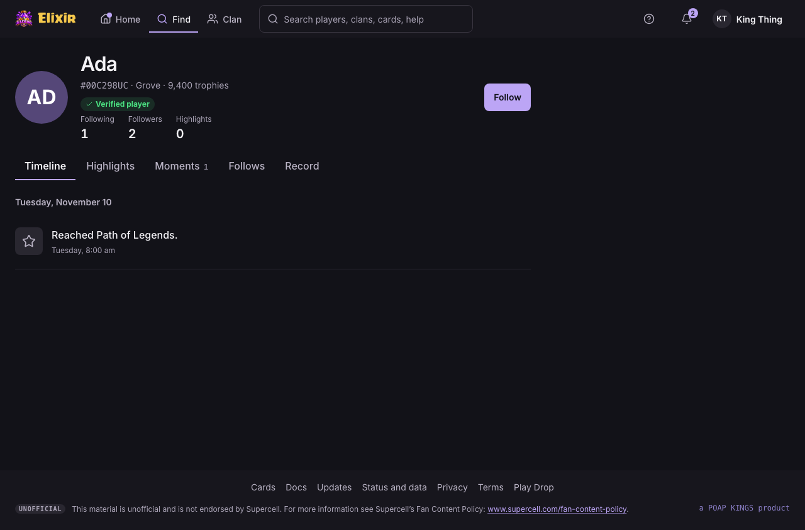

# Elixir visual direction

Draft direction checkpoint. Screenshots use invented-player Playwright fixtures at actual 390 × 844 and 1280 × 844 viewports. Each link opens its original PNG. The full-page captures include the footer and below-the-fold content.

| Page | Phone | Desktop | Full phone | Full desktop |
| --- | --- | --- | --- | --- |
| Home | [Before](before/home-390.png) / [After](after/home-390.png) | [Before](before/home-1280.png) / [After](after/home-1280.png) | [Before](before/home-390-full.png) / [After](after/home-390-full.png) | [Before](before/home-1280-full.png) / [After](after/home-1280-full.png) |
| Player | [Before](before/player-390.png) / [After](after/player-390.png) | [Before](before/player-1280.png) / [After](after/player-1280.png) | [Before](before/player-390-full.png) / [After](after/player-390-full.png) | [Before](before/player-1280-full.png) / [After](after/player-1280-full.png) |
| Find | [Before](before/find-390.png) / [After](after/find-390.png) | [Before](before/find-1280.png) / [After](after/find-1280.png) | [Before](before/find-390-full.png) / [After](after/find-390-full.png) | [Before](before/find-1280-full.png) / [After](after/find-1280-full.png) |
| Stats | [Before](before/stats-390.png) / [After](after/stats-390.png) | [Before](before/stats-1280.png) / [After](after/stats-1280.png) | [Before](before/stats-390-full.png) / [After](after/stats-390-full.png) | [Before](before/stats-1280-full.png) / [After](after/stats-1280-full.png) |
| Clan | [Before](before/clan-390.png) / [After](after/clan-390.png) | [Before](before/clan-1280.png) / [After](after/clan-1280.png) | [Before](before/clan-390-full.png) / [After](after/clan-390-full.png) | [Before](before/clan-1280-full.png) / [After](after/clan-1280-full.png) |
| Settings | [Before](before/settings-390.png) / [After](after/settings-390.png) | [Before](before/settings-1280.png) / [After](after/settings-1280.png) | [Before](before/settings-390-full.png) / [After](after/settings-390-full.png) | [Before](before/settings-1280-full.png) / [After](after/settings-1280-full.png) |
| Site | [Before](before/site-390.png) / [After](after/site-390.png) | [Before](before/site-1280.png) / [After](after/site-1280.png) | [Before](before/site-390-full.png) / [After](after/site-390-full.png) | [Before](before/site-1280-full.png) / [After](after/site-1280-full.png) |
| Docs | [Before](before/docs-390.png) / [After](after/docs-390.png) | [Before](before/docs-1280.png) / [After](after/docs-1280.png) | [Before](before/docs-390-full.png) / [After](after/docs-390-full.png) | [Before](before/docs-1280-full.png) / [After](after/docs-1280-full.png) |
| Battle | [Before](before/battle-390.png) / [After](after/battle-390.png) | [Before](before/battle-1280.png) / [After](after/battle-1280.png) | [Before](before/battle-390-full.png) / [After](after/battle-390-full.png) | [Before](before/battle-1280-full.png) / [After](after/battle-1280-full.png) |

## Home at 390px

| Before | After |
| --- | --- |
|  |  |

## Home at 1280px

| Before | After |
| --- | --- |
|  |  |

## Player at 390px

| Before | After |
| --- | --- |
|  |  |

## Player at 1280px

| Before | After |
| --- | --- |
|  |  |

See the [change note](../../notes/2026-11-14-visual-direction.md) for counts, scope, validation, reproduction and the bell follow-up.
